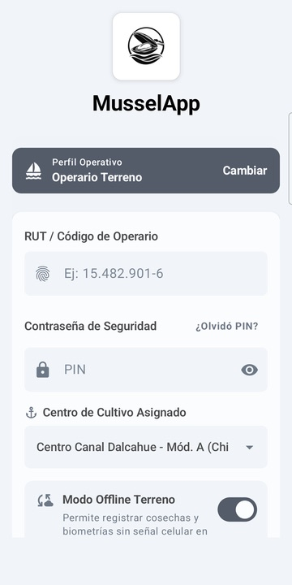
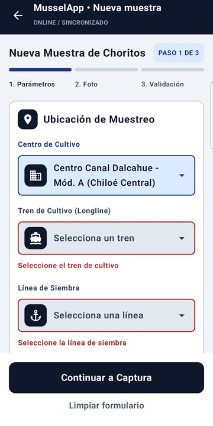
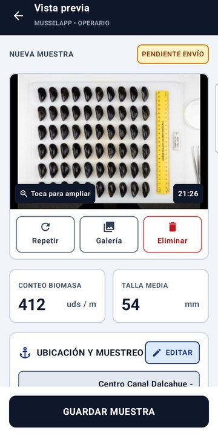
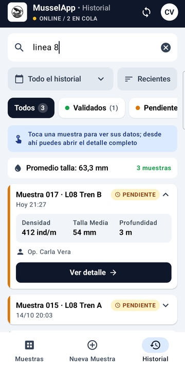
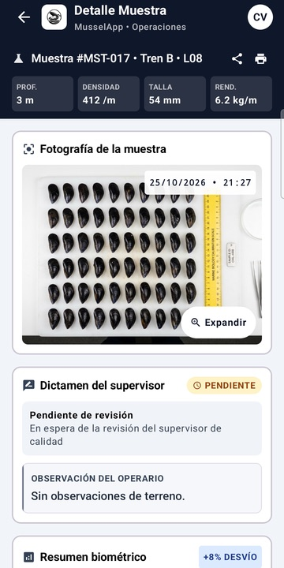
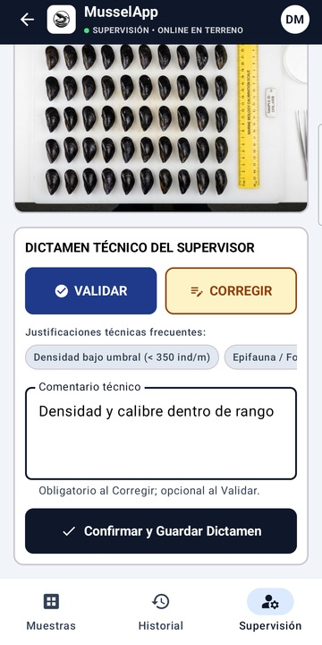
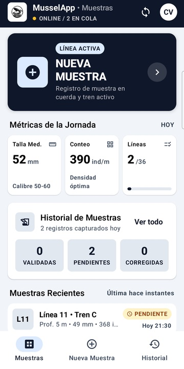
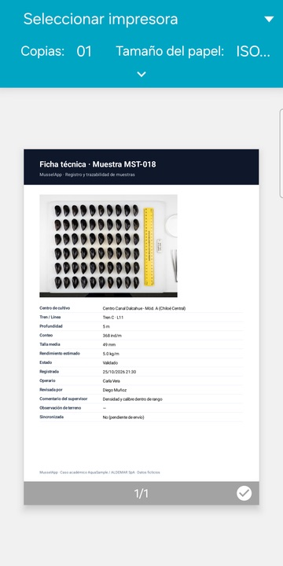
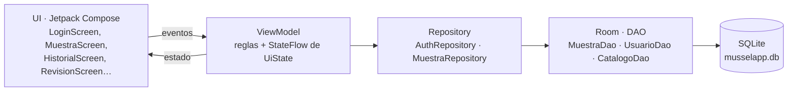
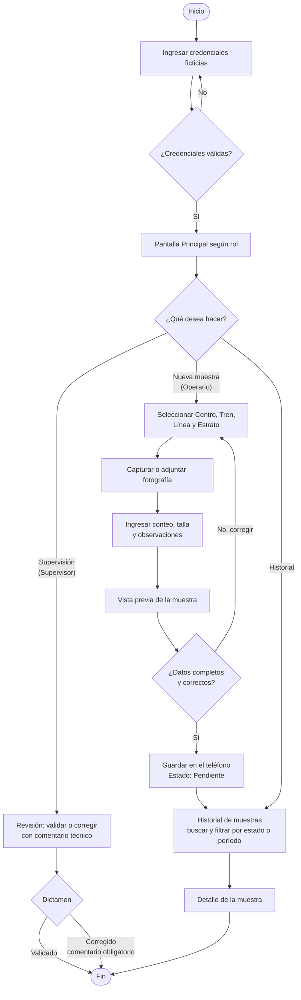

<p align="center">
  
</p>

<h1 align="center">MusselApp</h1>

<p align="center">
  App móvil para el registro y trazabilidad de muestras de choritos en centros de cultivo.<br>
  Caso académico <strong>AquaSample · ALDEMAR SpA</strong> · DSY1105 Desarrollo de Aplicaciones Móviles · Duoc UC Sede Puerto Montt
</p>

---

## 1. Descripción

En el muestreo de líneas de cultivo de choritos, el operario extrae un tramo representativo de la cuerda, cuenta los individuos, toma fotografías y registra observaciones. Hoy ese flujo es manual y la información queda dispersa entre planillas, fotos y notas, lo que dificulta el seguimiento histórico de una misma línea y la revisión del supervisor.

**MusselApp** es un MVP Android que digitaliza ese proceso en terreno:

- El **operario** registra la muestra (centro, tren, línea y estrato), adjunta una fotografía, ingresa conteo y talla, y la guarda en el teléfono aunque no haya señal.
- El **supervisor** revisa las muestras pendientes y las deja **Validadas** o **Corregidas** con un comentario técnico.
- Todo queda en un **historial** consultable, con búsqueda, filtros y detalle de cada muestra.

> Proyecto académico con datos ficticios. No reemplaza el criterio técnico de ALDEMAR ni realiza conteo automático.

## 2. Funcionalidades implementadas

| Funcionalidad | Dónde se ve | Implementación |
|---|---|---|
| Inicio de sesión por rol (operario / supervisor) | Login | `LoginViewModel` + `RoomAuthRepository`; RUT con dígito verificador (módulo 11) y formato en vivo |
| Formulario de muestra con campos obligatorios y mensajes de error | Nueva muestra | `MuestraViewModel.guardar()` valida centro, tren, línea y estrato |
| Fotografía de evidencia con cámara o galería | Captura | CameraX con permiso `CAMERA` en tiempo de ejecución; galería con Photo Picker (`PickVisualMedia`) |
| Conteo, talla y observación con validación de rangos | Vista previa | `validarBorrador()` en `BorradorMuestra.kt`; confirmación antes de guardar |
| Persistencia local que se conserva al cerrar la app | Todas | Room (SQLite): 6 entidades, 3 DAO, migraciones versionadas |
| Historial con búsqueda, filtros por estado y período, y orden | Historial | `HistorialViewModel` (`combine` + `stateIn`) y `FiltrosHistorial` |
| Detalle de la muestra con dictamen del supervisor | Detalle | `DetalleViewModel` lee la muestra por id desde Room |
| Ficha técnica en PDF: guardar, imprimir o compartir | Detalle | `FichaPdf` con `PrintManager` y `FileProvider` |
| Revisión del supervisor: validar o corregir (comentario obligatorio al corregir) | Supervisión | `RevisionViewModel` registra la revisión y cambia el estado |
| Métricas de la jornada y muestras recientes | Principal | `PrincipalViewModel` + `ResumenJornada` |
| Seguridad local | Login | PIN guardado con hash PBKDF2, bloqueo tras 5 intentos fallidos y base excluida del respaldo |

**Recursos del dispositivo integrados al flujo:** cámara, galería (Photo Picker), documentos (ficha PDF para imprimir o compartir) y fecha/hora del registro.

## 3. Capturas

| Login | Nueva muestra | Vista previa | Historial |
|---|---|---|---|
|  |  |  |  |

| Detalle | Revisión del supervisor | Principal | Ficha PDF |
|---|---|---|---|
|  |  |  |  |

## 4. Instrucciones de ejecución

### Requisitos

- **Android Studio** reciente (con soporte para AGP 9.3) y su JDK incluido.
- **Android SDK** con la plataforma **API 37** (`compileSdk`/`targetSdk` 37).
- Teléfono o emulador con **Android 7.0 (API 24)** o superior. Para probar la cámara se recomienda un teléfono físico.

### Pasos

1. Clonar el repositorio:
   ```bash
   git clone https://github.com/jesuscardenas-jacv1/Proyecto-ALDEMAR.git
   ```
2. Abrir la carpeta `Proyecto-ALDEMAR` en Android Studio y esperar la sincronización de Gradle.
3. Conectar un teléfono con la **depuración USB** activada (o iniciar un emulador).
4. Elegir la configuración **app** y presionar **Run ▶**.

También se puede compilar desde la terminal:

```bash
./gradlew assembleDebug        # genera app/build/outputs/apk/debug/app-debug.apk
./gradlew installDebug         # instala en el teléfono conectado
```

### Usuarios de prueba

La base se llena con datos ficticios la primera vez que se abre la app.

| Rol | RUT | PIN | Qué puede hacer |
|---|---|---|---|
| Operario (Carla Vera) | `11.111.111-1` | `1234` | Registrar muestras, ver historial y detalle |
| Supervisor (Diego Muñoz) | `22.222.222-2` | `1234` | Revisar, validar o corregir muestras |

En el Login se elige el perfil, se ingresa RUT y PIN, y el centro de cultivo de la jornada.

### Pruebas automatizadas

```bash
./gradlew testDebugUnitTest          # 55 pruebas unitarias (validaciones, filtros, ViewModels, hash del PIN)
./gradlew connectedDebugAndroidTest  # 16 pruebas instrumentadas con Room real (requiere teléfono o emulador)
```

## 5. Arquitectura

La app sigue **MVVM**: la pantalla solo dibuja el estado, el ViewModel aplica las reglas y expone un `StateFlow<UiState>`, y el Repository es el único que habla con Room.



```
app/src/main/java/cl/aldemar/musselapp/
├── AppContainer.kt          # crea la base y los repositorios (una sola vez)
├── data/
│   ├── local/               # Room: MusselDatabase, Migraciones, dao/, entidad/
│   ├── model/               # Muestra, Usuario, Rol, EstadoMuestra, CentroCultivo
│   └── repository/          # interfaces + implementaciones Room y de prueba
├── ui/
│   ├── login/ principal/ muestra/ screens/ historial/ detalle/ revision/
│   ├── navegacion/          # Rutas y MusselNavHost
│   ├── componentes/         # componentes reutilizables
│   └── theme/               # colores, tipografía y tema Material 3
└── util/                    # RutValidator, Fechas, FichaPdf, HashPin, AlmacenFotos…
```

El modelo de datos (diagrama entidad-relación y tablas) está documentado en [`docs/base-de-datos.md`](docs/base-de-datos.md).

## 6. Integrantes — Equipo Pipeño (Sección 004V)

| Nombre | GitHub | Rol |
|---|---|---|
| Jesús Cárdenas | [@jesuscardenas-jacv1](https://github.com/jesuscardenas-jacv1) | Front-end |
| Ramón Osorio | [@KanninoX](https://github.com/KanninoX) | UI/UX & Mobile Developer |
| Lucas Saldivia | [@lucsaldivia-ux](https://github.com/lucsaldivia-ux) | QA & Data Engineer |

## 7. Trabajo colaborativo

- **Ramas:** cada tarea se desarrolla en su propia rama (`feature/…` o `fix/…`); nunca directamente en `main`.
- **Pull Requests:** todo cambio entra a `main` por PR, con descripción, capturas y pasos para probar, revisado por otro integrante.
- **Commits** técnicos en español con prefijo (`feat:`, `fix:`, `test:`, `docs:`, `refactor:`).
- **Issues:** los hallazgos de la revisión técnica se registran como issues asignados.
- **Planificación:** pendientes y responsables en Trello — _enlace pendiente_.

## 8. Tecnologías

- **Kotlin** + **Jetpack Compose** con **Material 3**
- Arquitectura **MVVM** con **ViewModel** y **StateFlow**
- **Navigation Compose**
- Persistencia local con **Room 2.8** (SQLite, KSP)
- **CameraX** y Activity Result API (permisos, Photo Picker)
- **Gradle** (Kotlin DSL), Android Studio
- Diseño: **Google Stitch**, Mermaid para UML

## 9. Identidad visual

| Elemento | Definición |
|---|---|
| Nombre | **MusselApp** |
| Logotipo | [`docs/diseno/logo.png`](docs/diseno/logo.png) · [`logo.svg`](docs/diseno/logo.svg) — representa el chorito chileno y la conexión con el mar del sur de Chile |

### Paleta de colores

| Color | HEX | Uso |
|---|---|---|
| Principal | `#0F172A` | Encabezados, TopAppBar y botones de acción clave (CTA) |
| Secundario | `#334155` | Encabezados de tablas, botones secundarios y navegación |
| Fondo | `#F1F5F9` | Fondo general; evita deslumbramiento bajo luz solar directa |
| Texto | `#000000` | Títulos, lecturas de datos y etiquetas de alto contraste |
| Adicional | `#475569` | Bordes de tarjetas, divisores, textos secundarios y metadatos (contraste AA) |

Paleta sobria y de alto contraste, pensada para una empresa de servicios y para uso en terreno.

## 10. Flujo de usuario (Diagrama de Actividad UML)

Imagen exportada: [`docs/diseno/flujo-usuario-uml.png`](docs/diseno/flujo-usuario-uml.png) · Fuente: [`flujo-usuario-uml.mmd`](docs/diseno/flujo-usuario-uml.mmd)



## 11. Diseño de interfaces

Diseños base generados con **Google Stitch** (Material Design 3), guardados en [`docs/diseno/interfaces/`](docs/diseno/interfaces/). Las capturas de la app real están en la sección 3.

| Pantalla | Objetivo | Diseño |
|---|---|---|
| Login | Verificación de credenciales de los usuarios | [`01-login.png`](docs/diseno/interfaces/01-login.png) |
| Principal | Menú de opciones según el rol | [`02-principal.png`](docs/diseno/interfaces/02-principal.png) |
| Muestra | Iniciar un muestreo | [`03-muestra.png`](docs/diseno/interfaces/03-muestra.png) |
| Captura | Capturar un registro visual de la muestra | [`04-captura.png`](docs/diseno/interfaces/04-captura.png) |
| Vista previa | Previsualizar fotografía y datos, y confirmar el muestreo | [`05-vista-previa.png`](docs/diseno/interfaces/05-vista-previa.png) |
| Historial | Listar las muestras registradas | [`06-historial.png`](docs/diseno/interfaces/06-historial.png) |
| Detalle | Ver en detalle una muestra seleccionada | [`07-detalle.png`](docs/diseno/interfaces/07-detalle.png) |
| Revisión del Supervisor | Gestionar el estado de las muestras | [`08-revision.png`](docs/diseno/interfaces/08-revision.png) |

### Navegación

| Componente | ¿Se utiliza? | Para qué |
|---|---|---|
| NavigationBar | Sí | Operario: Muestras, Nueva Muestra e Historial · Supervisor: Muestras, Historial y Supervisión |
| NavigationDrawer | No | — |
| TopAppBar | Sí | Título de pantalla, volver, sincronizar y menú de perfil (cerrar sesión) |
| Botón principal | Sí | Tarjeta "Nueva muestra" (operario) o "Revisar muestras" (supervisor) en la Principal |

## 12. Estructura del repositorio

```
app/                         # código fuente de la app Android
├── schemas/                 # esquemas exportados de Room (uno por versión)
└── src/
    ├── main/                # código, recursos y AndroidManifest.xml
    ├── test/                # pruebas unitarias
    └── androidTest/         # pruebas instrumentadas (Room)
docs/
├── base-de-datos.md         # modelo de datos
├── capturas/                # capturas de la app real
├── diseno/
│   ├── logo.png · logo.svg
│   ├── flujo-usuario-uml.png · flujo-usuario-uml.mmd
│   └── interfaces/          # pantallas diseñadas en Stitch
└── evidencias/
    └── clase-02/            # Evidencia_Clase_02_Diseno_EquipoPipeno
```
